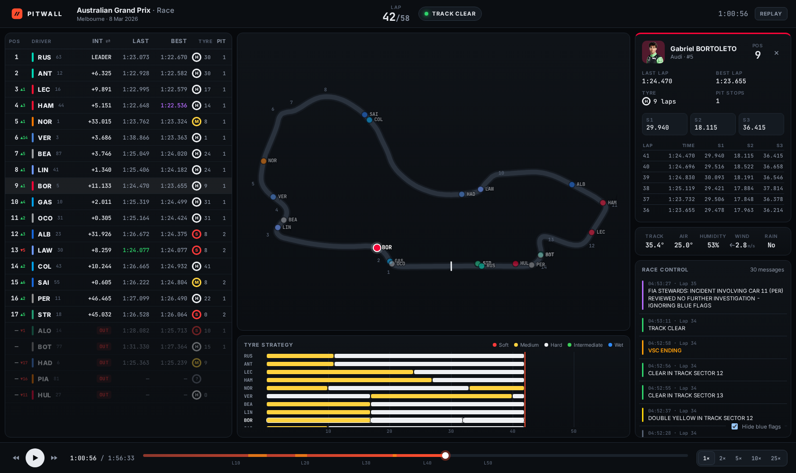
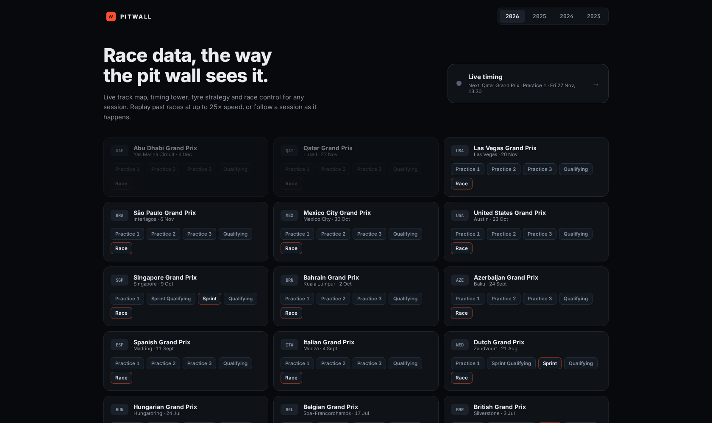

# Pitwall

A pit wall style dashboard for Formula 1 sessions. Follow a session live, or replay any past race, qualifying or practice session with a live track map, timing tower, tyre strategy and race control feed.



## Features

- **Track map** with every car moving in real time, team colours, corner numbers, the start/finish line and yellow-flag marshal sectors lit up as they happen. Click a car to follow it.
- **Timing tower** with position, places gained or lost, interval or gap to the leader, last and best laps (purple for fastest overall, green for a personal best), tyre compound and age, and pit stops. Rows slide into place as positions change.
- **Race replay** for any finished session since 2023: play, pause, scrub, and 1× to 25× speed. Safety car, VSC and red flag periods are marked on the timeline.
- **Live mode** that connects to the official live timing feed during a session, with a countdown to the next session when nothing is running.
- **Tyre strategy chart** showing every stint so far.
- **Driver card** with headshot, sectors and recent lap history.
- **Race control feed** with flags, penalties, safety cars and investigations. Blue flags can be hidden.
- **Weather**: track and air temperature, humidity, wind and rain.
- Qualifying gaps are worked out per part (Q1, Q2, Q3), so they follow the knockout rules.

| Qualifying | Session picker |
| --- | --- |
|  |  |

## Getting started

You need **Node.js 22** or newer.

```bash
git clone https://github.com/landsley-tech/pitwall.git
cd pitwall
npm run setup      # installs root, server and web dependencies
npm run build      # builds the web app
npm start          # http://localhost:8787
```

For development with hot reload:

```bash
npm run dev        # web on http://localhost:5173, API on :8787
```

The first time you open a session, the server downloads it from OpenF1 and builds a compact replay (about a minute for a race). It's cached in `.cache/`, so after that it opens instantly.

## How it works

```
                ┌──────────────── server (Node + TypeScript) ────────────────┐
OpenF1 API ───► │ replay builder: positions, laps, gaps, stints, race control │──► /api/replay/:key (gzipped JSON)
MultiViewer ──► │ circuit outlines: shape, rotation, corners, marshal sectors │──► /api/circuit/:key/:year
F1 live feed ─► │ SignalR client: merges incremental updates into one state   │──► /ws/live (WebSocket)
                └─────────────────────────────────────────────────────────────┘
                                              │
                ┌──────────────── web (React + Vite + Canvas) ───────────────┐
                │ ReplayEngine: works out the full race state for any moment  │
                │ TrackMap: canvas at 60fps, cars interpolated between samples│
                └─────────────────────────────────────────────────────────────┘
```

- **Replays** come from the free [OpenF1](https://openf1.org) API. Car positions are fetched in 10-minute chunks for every car at once, with requests queued and retried to stay inside the rate limit. They're stored delta-encoded, so a full race is about 1.5 MB gzipped.
- **Replay and live modes share the same `RaceState` shape**, so every panel works the same way in both.
- **Live timing** uses F1's SignalR Core feed. Some topics arrive compressed (`.z`, raw deflate + base64), and updates patch arrays using index-keyed objects. `server/src/live.ts` handles both, and there are tests for it.

## Live car positions

The live feed sends timing, tyres, race control, weather and lap counts to anyone, but **car GPS positions need an F1 TV subscription**. So:

- **Without a token**, live races still get a map. Cars are placed along the track from the leader's lap progress and each car's interval to the car ahead, and the map is labelled *Estimated positions*.
- **With a token**, set `F1TV_TOKEN` before starting the server to request the real position feed:

  ```bash
  F1TV_TOKEN=your-token npm start
  ```

  The token-based path follows the feed's documented format but hasn't been tested against a live session yet.

Replays always use real positions.

## Project layout

```
server/src/
  index.ts      HTTP + WebSocket server, serves the built web app
  openf1.ts     rate-limited, cached OpenF1 client
  replay.ts     builds replay files
  circuit.ts    track outlines
  live.ts       live timing client and parser (+ live.test.ts)
web/src/
  lib/replay.ts       ReplayEngine: race state at any timestamp
  lib/useLive.ts      live WebSocket hook with position buffering
  components/         TrackMap, TimingTower, StrategyChart, ReplayControls, ...
  views/              ReplayView, LiveView
shared/types.ts       types used by both sides
```

## Scripts

| Command | What it does |
| --- | --- |
| `npm run setup` | Install all dependencies |
| `npm run dev` | Run server and web app with hot reload |
| `npm run build` | Build the web app into `web/dist` |
| `npm start` | Serve the API and built app on port 8787 (`PORT` to change) |
| `npm run typecheck` | Type-check server and web |
| `npm --prefix server test` | Run the live-feed parser tests |

## Disclaimer

This is an unofficial project and isn't associated in any way with the Formula 1 companies. F1, FORMULA ONE, FORMULA 1, FIA FORMULA ONE WORLD CHAMPIONSHIP, GRAND PRIX and related marks are trademarks of Formula One Licensing B.V. Data comes from OpenF1, the public live timing feed and the MultiViewer circuit API, for personal and educational use.

## Licence

MIT
