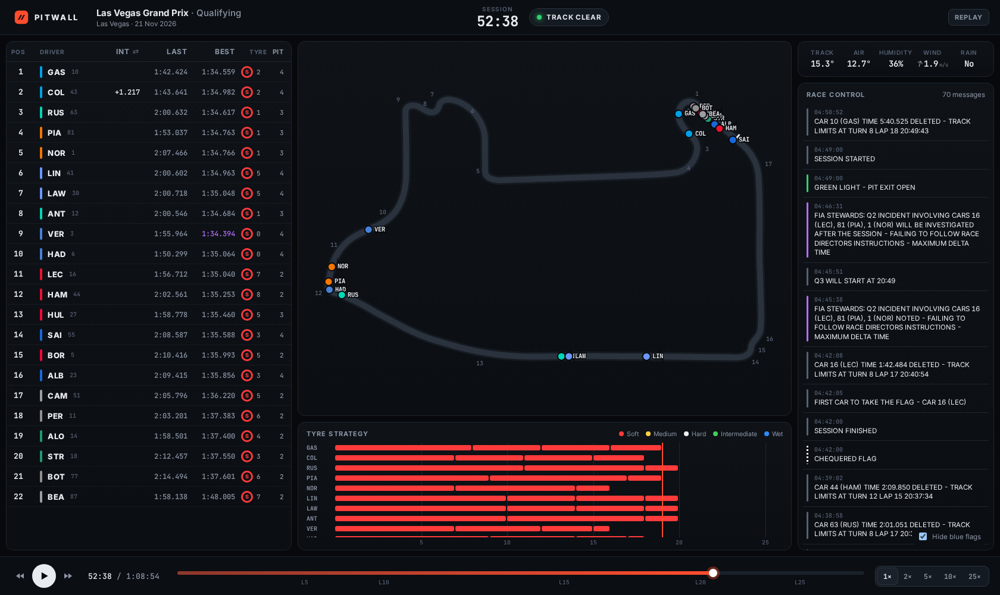
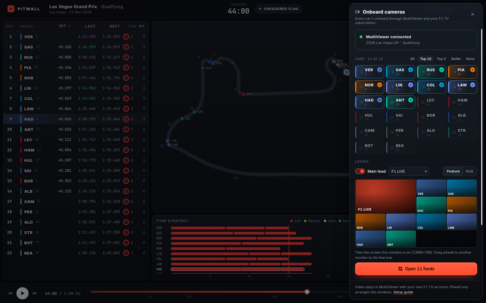

# Pitwall

A pit wall style dashboard for Formula 1 sessions. Follow a session live, or replay any past race, qualifying or practice session with a live track map, timing tower, tyre strategy and race control feed. With an F1 TV subscription it can also put every car's onboard camera on screen in one grid, kept in step with the replay.


## Features

- **Track map** with every car moving in real time, team colours, corner numbers, the start/finish line and yellow-flag marshal sectors lit up as they happen. Click a car to follow it.
- **Timing tower** with position, places gained or lost, interval or gap to the leader, last and best laps (purple for fastest overall, green for a personal best), tyre compound and age, and pit stops. Rows slide into place as positions change.
- **Race replay** for any finished session since 2023: play, pause, scrub, and 1× to 25× speed. Safety car, VSC and red flag periods are marked on the timeline.
- **Live mode** that connects to the official live timing feed during a session, with a countdown to the next session when nothing is running.
- **Tyre strategy chart** showing every stint so far.
- **Driver card** with headshot, sectors and recent lap history.
- **Race control feed** with flags, penalties, safety cars and investigations. Blue flags can be hidden.
- **Weather**: track and air temperature, humidity, wind and rain.
- **Onboard cameras**: open one car's onboard, or tile every car (plus the main broadcast) across a screen as a video wall, through [MultiViewer](https://multiviewer.app) and your own F1 TV account. In replays the video follows the timeline. See [Onboard cameras](#onboard-cameras).
- Smooth motion throughout: rows slide as positions change and flash on a gain or loss, panels ease in, a sweeping light on the top edge for safety cars and red flags, and fades between screens. All of it switches off if your system asks for reduced motion.
- Qualifying gaps are worked out per part (Q1, Q2, Q3), so they follow the knockout rules.

| Qualifying | Session picker |
| --- | --- |
|  |  |

## Getting started

You need **Node.js 22** or newer.

```bash
git clone https://github.com/landsley-tech/pitwall.git
cd pitwall
npm run setup      # installs root, server and web dependencies
npm run build      # builds the web app
npm start          # http://localhost:8787
```

For development with hot reload:

```bash
npm run dev        # web on http://localhost:5173, API on :8787
```

The first time you open a session, the server downloads it from OpenF1 and builds a compact replay (about a minute for a race). It's cached in `.cache/`, so after that it opens instantly.

### Settings

Settings are environment variables. The easiest way is a `.env` file in the project folder, which is read on start and ignored by git:

```bash
cp .env.example .env
nano .env
```

| Variable | Default | What it does |
| --- | --- | --- |
| `PORT` | `8787` | Port for the web app and API |
| `F1TV_TOKEN` | none | F1 TV token for real car positions during live sessions ([how to get it](#2-f1-tv-token-for-live-car-positions)) |
| `MULTIVIEWER_URL` | `http://localhost:10101/api/graphql` | Where MultiViewer's local API is |
| `PITWALL_REMOTE_CONTROL` | off | `1` lets other devices open and control onboard windows on this machine |
| `PITWALL_CACHE` | `.cache/` | Where replays and track maps are cached |

Anything you set in the shell (`PORT=9000 npm start`) wins over `.env`.

## Linking F1 TV

Pitwall works without F1 TV. Replays, live timing, the map and everything else are free. An F1 TV Pro or Premium subscription unlocks two extras, and each is linked separately:

| Extra | Linked through | Needed for |
| --- | --- | --- |
| Onboard cameras and the main broadcast | MultiViewer, signed in to F1 TV | [Onboard cameras](#onboard-cameras) |
| Real car GPS during live sessions | `F1TV_TOKEN` | [Live car positions](#live-car-positions) |

### 1. MultiViewer, for video

[MultiViewer](https://multiviewer.app) is a free desktop app that plays F1 TV, including every onboard, with the DRM protection the streams need. Pitwall doesn't play any video itself. It tells MultiViewer which feeds to open and where to put the windows.

1. Download MultiViewer for your system from [multiviewer.app/download](https://multiviewer.app/download). Windows, macOS and Linux builds are available. On Fedora, pick the Linux package that fits (e.g. the `.rpm`) and install it with `sudo dnf install ./<file>.rpm`.
2. Open it and sign in with your F1 TV account. Onboards need **F1 TV Pro or Premium**, not F1 TV Access.
3. Leave it running. Pitwall looks for it at `http://localhost:10101` and shows a green dot on the **Onboards** button when it finds it. Nothing to paste or configure.

Check it's reachable with:

```bash
curl -s -X POST -H 'Content-Type: application/json' -d '{"query":"{ version }"}' http://localhost:10101/api/graphql
```

The reply should be something like `{"data":{"version":"…"}}`.

### 2. F1 TV token, for live car positions

The live timing feed only sends car GPS positions to F1 TV subscribers. To get your token:

1. Sign in at [f1tv.formula1.com](https://f1tv.formula1.com) in your browser.
2. Open the developer tools (F12) → **Storage** (Firefox) or **Application** (Chrome) → **Cookies** → `https://f1tv.formula1.com`.
3. Copy the value of the cookie called `login-session`. It's URL-encoded JSON.
4. Get the token out of it:

   ```bash
   python3 -c 'import json,sys,urllib.parse; print(json.loads(urllib.parse.unquote(sys.argv[1]))["data"]["subscriptionToken"])' 'PASTE-THE-COOKIE-VALUE-HERE'
   ```

5. Put it in `.env` as `F1TV_TOKEN=eyJ…` and restart pitwall.

The token is effectively your login, so keep it out of git, screenshots and chats. It expires after a few days. When live positions go back to *Estimated positions*, repeat these steps. The cookie name and layout are F1's and may change; this is how it works at the time of writing.

## How it works

```
                ┌──────────────── server (Node + TypeScript) ────────────────┐
OpenF1 API ───► │ replay builder: positions, laps, gaps, stints, race control │──► /api/replay/:key (gzipped JSON)
MultiViewer ──► │ circuit outlines: shape, rotation, corners, marshal sectors │──► /api/circuit/:key/:year
 meta API   ──► │ F1 TV content id + video sync offset for each session       │──► /api/onboard/session/:key
F1 live feed ─► │ SignalR client: merges incremental updates into one state   │──► /ws/live (WebSocket)
                │ onboard control: tiles windows, checks every request        │──► /api/onboard/{status,open,control}
                └──────────────┬─────────────────────────────────┬────────────┘
                               │                                 │ GraphQL on localhost:10101
                               │                                 ▼
                               │                  MultiViewer app (signed in to F1 TV)
                               │                  plays the onboard and broadcast windows
                               ▼
                ┌──────────────── web (React + Vite + Canvas) ───────────────┐
                │ ReplayEngine: works out the full race state for any moment  │
                │ TrackMap: canvas at 60fps, cars interpolated between samples│
                │ Onboards panel: picks feeds, previews the wall, follows the │
                │ replay clock                                                │
                └─────────────────────────────────────────────────────────────┘
```

- **Replays** come from the free [OpenF1](https://openf1.org) API. Car positions are fetched in 10-minute chunks for every car at once, with requests queued and retried to stay inside the rate limit. They're stored delta-encoded, so a full race is about 1.5 MB gzipped.
- **Replay and live modes share the same `RaceState` shape**, so every panel works the same way in both.
- **Onboard cameras** never touch video. The server sends MultiViewer a fixed set of GraphQL operations (`playerCreate`, `playerSeekTo`, `playerSync`, …) with every value passed as a variable. The window tiling in `shared/onboardLayout.ts` is shared by the server and the browser preview, so the preview is exactly what opens. Replay sync maps the replay clock onto the video: *video time = session start in the video + (replay moment − session start time)*.
- **Live timing** uses F1's SignalR Core feed. Some topics arrive compressed (`.z`, raw deflate + base64), and updates patch arrays using index-keyed objects. `server/src/live.ts` handles both, and there are tests for it.

## Live car positions

The live feed sends timing, tyres, race control, weather and lap counts to anyone, but **car GPS positions need an F1 TV subscription**. So:

- **Without a token**, live races still get a map. Cars are placed along the track from the leader's lap progress and each car's interval to the car ahead, and the map is labelled *Estimated positions*.
- **With a token**, put `F1TV_TOKEN` in `.env` (see [how to get it](#2-f1-tv-token-for-live-car-positions)) or set it when starting the server, and pitwall requests the real position feed:

  ```bash
  F1TV_TOKEN=your-token npm start
  ```

  The token-based path follows the feed's documented format but hasn't been tested against a live session yet.

Replays always use real positions.

## Onboard cameras



Press **Onboards** in the top bar (or the **O** key) to open the camera panel. You need [MultiViewer set up](#1-multiviewer-for-video) first. Until it is, the panel shows the setup steps.

### A video wall of every car

1. Pick the cars. All the cars still running are picked by default. **Top 10**, **Top 5** and **Battle** (the selected car and two either side) are quick picks, or click cars to toggle them.
2. Choose whether to include a **main feed** (F1 LIVE, INTERNATIONAL, TRACKER or DATA) and a layout:
   - **Feature**: the main feed big in the corner, onboards around it.
   - **Grid**: equal tiles.

   The preview shows exactly where each window will go. 20 cars on a 1920×1080 screen is a 5×4 grid of 384×216 windows.
3. Press **Open**. MultiViewer opens a window per feed and tiles them over the screen the pitwall window is on. To build the wall on a TV or second monitor, drag pitwall onto that screen first.

Leave **Close MultiViewer's open windows first** ticked to swap one wall for another cleanly.

### One car

Hover a row in the timing tower and click the camera icon, or select a car and press **Watch onboard** on its driver card. That car's onboard opens in its own MultiViewer window.

### Keeping in step

- **Replays**: with **Follow the replay** on, the video jumps to the same moment as the replay when you play, pause, skip or scrub. It plays along at 1×. Video can't run at 2–25×, so at faster speeds the windows pause and catch up when you drop back to 1× or pause. Sync uses MultiViewer's timing data for each session (where the session starts in the F1 TV video). The panel says when a session doesn't have it.
- **Live**: press **Sync** to line every window up with the main feed (or the first window). F1 TV's video runs a few seconds behind the timing data, so the map and tower will be slightly ahead of the pictures.
- **Pause, Play, Mute all, Close all** act on every MultiViewer window.

### Good to know

- **Helmet cams**: F1 TV doesn't have a separate helmet-cam feed per driver. When a driver's car carries a helmet camera, it appears as one of the angles on that driver's onboard.
- Not every car has an onboard in every session (practice especially). When one is missing, the rest still open and a note lists the ones that didn't.
- Opening the whole grid at once means 20+ HD streams. That's roughly 100 Mbit/s and a lot of video decoding, so start with Top 10 on a modest machine.
- F1 TV limits how many devices can stream at once. The MultiViewer windows count as one, but a phone or TV watching at the same time may not.
- **Wayland (Fedora's default desktop)**: apps aren't allowed to place their own windows, so the windows may open the right size but stacked. If that happens, start MultiViewer under XWayland so the tiling works: launch it with `--ozone-platform=x11`, or edit its `.desktop` file to add the flag.
- Bookmark `http://localhost:8787/?onboards#live` on the machine driving the TV to land on live timing with the camera panel already open.

### Using a phone or tablet as the remote

Onboard windows always open on the computer running pitwall and MultiViewer. For safety, only that computer can control them unless you allow other devices:

```bash
PITWALL_REMOTE_CONTROL=1 npm start
```

Then open pitwall from the other device (e.g. `http://<your-pc>:8787` on the same network or tailnet) and use the Onboards panel as a remote. Only turn this on for networks you trust. Anyone who can reach the port can open and close windows on that machine.

### Troubleshooting

| What you see | Fix |
| --- | --- |
| "MultiViewer isn't running" | Open MultiViewer, sign in, then **Check again**. Run the `curl` check above. If MultiViewer is on another port, set `MULTIVIEWER_URL`. |
| "This session isn't on F1 TV (yet)" | F1 TV has no video for that session yet, or it's a session MultiViewer doesn't list. Live sessions show up shortly before they start. |
| Windows open but play an error | The F1 TV account in MultiViewer needs Pro/Premium, or is streaming on too many devices. |
| Windows open stacked instead of tiled | See the Wayland note above. |
| "Only works on the machine running pitwall" | You're on another device. See [Using a phone or tablet as the remote](#using-a-phone-or-tablet-as-the-remote). |
| Follow the replay is greyed out | MultiViewer has no sync data for this session. Use **Sync** and line the main feed up by hand in MultiViewer. |

## Project layout

```
server/src/
  index.ts      HTTP + WebSocket server, serves the built web app
  openf1.ts     rate-limited, cached OpenF1 client
  replay.ts     builds replay files
  circuit.ts    track outlines
  live.ts       live timing client and parser (+ live.test.ts)
  onboard.ts    MultiViewer control, request checks (+ onboard.test.ts)
  env.ts        loads .env
web/src/
  lib/replay.ts       ReplayEngine: race state at any timestamp
  lib/useLive.ts      live WebSocket hook with position buffering
  lib/onboard.ts      onboard API client, replay follow
  components/OnboardDrawer.tsx   the camera panel
  components/         TrackMap, TimingTower, StrategyChart, ReplayControls, ...
  views/              ReplayView, LiveView
shared/types.ts       types used by both sides
shared/onboardLayout.ts  window tiling used by both sides
```

## Scripts

| Command | What it does |
| --- | --- |
| `npm run setup` | Install all dependencies |
| `npm run dev` | Run server and web app with hot reload |
| `npm run build` | Build the web app into `web/dist` |
| `npm start` | Serve the API and built app on port 8787 (`PORT` to change) |
| `npm run typecheck` | Type-check server and web |
| `npm --prefix server test` | Run the server tests: live-feed parser, onboard tiling, validation, and attack tests (cross-site requests, DNS rebinding, other devices, injection, oversized bodies) against a fake MultiViewer |

## Disclaimer

This is an unofficial project and isn't associated in any way with the Formula 1 companies. F1, FORMULA ONE, FORMULA 1, FIA FORMULA ONE WORLD CHAMPIONSHIP, GRAND PRIX and related marks are trademarks of Formula One Licensing B.V. Data comes from OpenF1, the public live timing feed and the MultiViewer circuit and meeting APIs, for personal and educational use.

Video is played by MultiViewer using your own F1 TV subscription. Pitwall doesn't download, record, re-stream or decrypt any video, and it isn't affiliated with MultiViewer. F1 TV's terms are for personal viewing, so don't share or rebroadcast the feeds.

## Licence

MIT
